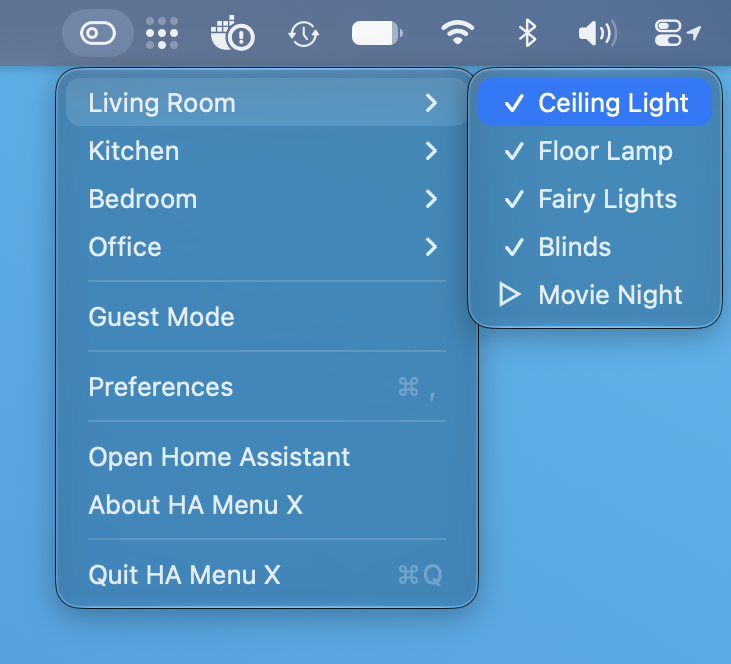
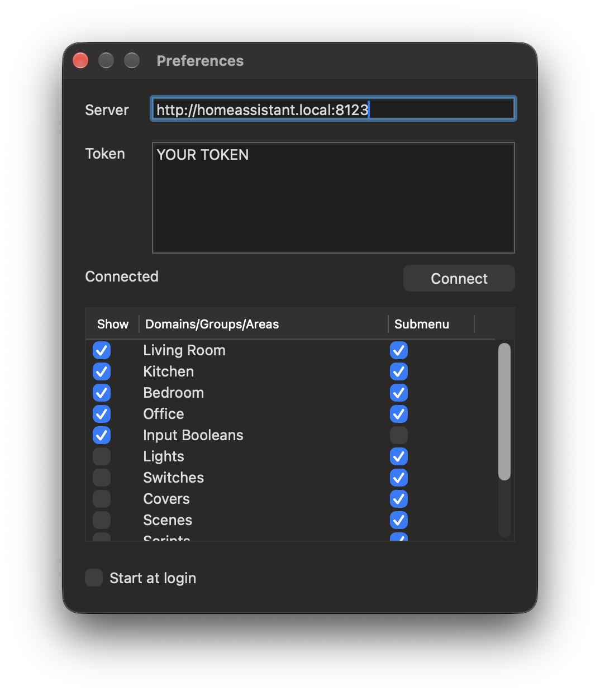

# HA Menu

[![GitHub Release][releases-shield]](releases)
[![Downloads][download-latest-shield]](Downloads)
[![License][license-shield]](LICENSE)


A MacOS Menu Bar app to perform common Home Assistant functions  
Currently HA Menu supports  
* Turning available switches, lights, automations and input_boolean's on and off
* Activating scenes, scripts, buttons and input_buttons
* input_select option menus  
* Opening and Closing Covers
* Viewing sensor values (Sensors have to be specifically added to a group)  

HA Menu supports MacOS 11.5 (Big Sur) and later.



## Installation
**Manual**  
Get the latest HA.Menu.zip from [Releases](https://github.com/codechimp-org/ha-menu/releases)  
Unzip and copy the HA Menu app to your Applications folder

**Homebrew Cask**  
2.6 or later ```brew install --cask ha-menu```  
2.5 or earlier ```brew cask install ha-menu```

## Configuration
You will have needed to enable Allow app's downloaded from App Store and identified developers enabled in Security & Privacy Settings to run.  

For the server connection you can use your local ip:port as per the example, an external facing address you have setup via DuckDNS or similar, or your Nabu Casa URL.  Ensure you prefix with http:// or https:// as appropriate.

To create a token within HA, login to HA and click on your profile.  
Under Long Lived Access Tokens, create a new token, give it a name and copy the token value into HA Menu preferences.

Press Connect to validate your connection and get your groups and areas.  You can now choose which domains/groups/areas to display within HA Menu, drag them to reorder and optionally make them a submenu. Double-click one to sort the entities within it.



### Domains

Within the preference screen you can choose which domains to display.  Domains are a list of all entities within that domain, e.g. Lights will display all lights within HA Menu.  
If you want to display just a few items from a domain, create a custom group as detailed below.   
Entities within domains are displayed alphabetically.

### Hiding entities

To hide a single entity, open HA Menu and hold the Option (⌥) key, each entity turns into a Hide item, click it to hide that entity.  
Hidden entities are removed from domains, groups and areas and are listed in the Hidden Entities submenu below Preferences, click one there to show it again.

### Areas (rooms)

The areas you have set up in HA are listed in preferences alongside domains and groups, in the order HA has them. Tick an area to show its entities, by default as a submenu named after the room.  
An entity belongs to an area when it is assigned to it directly or when its device is. Like HA's own area views, hidden entities and config/diagnostic entities are left out, as are sensors (add sensors to a group if you want to see them).  
When an entity's name starts with the area name it is shortened, e.g. "Kitchen Ceiling Light" is shown as "Ceiling Light" within Kitchen.

### Sorting items

Double-click a domain, group or area in preferences (or right-click it and choose Sort Items…) to drag its entities into the order you want them in the menu.  
Entities added to HA later are appended at the end. Reset to A–Z (or Reset to Group Order for groups) restores the default order.

### Groups

If you have a lot of entities within your domains you can have HA Menu display a specific set by [creating new groups within HA](https://www.home-assistant.io/integrations/group/).  
You can create multiple groups and they will be separated within the drop down menu.

First of all create your group(s) within groups.yaml as per the example.  Note the group entity id is ha_menu in this example.  Validate and Reload Groups within HA (Configuration/Server Controls) to have the group added to HA. If you want multiple groups just repeat the block and rename the entity id/name and change your entity's.

Once you have the group(s) added to HA, within HA Menu go to Preferences and tick the Groups you want to be displayed.   
Close preferences to save these settings.

Now when you click on HA Menu again the group's you have setup will be displayed.  Entities within groups are displayed in the order they are added within the group (printer, lego_lights, desk_lamp, notifications, entry_alert, who_cooks, outside_temperature in the example).  

Where sensors are included they will be displayed with a bullet in the menu, and show the friendly name, state/value and unit of measurement. Clicking on a sensor does not perform any action.   

Example groups.yaml
```yaml
ha_menu:
  name: HA Menu Switches
  entities:
    - switch.printer
    - switch.lego_lights
    - light.desk_lamp
    - input_boolean.notifications
    - automation.entry_alert
    - input_select.who_cooks
    - sensor.outside_temperature
```

## Say Thanks
If you would like to show your support for HA Menu

[](https://www.buymeacoffee.com/codechimp)

[license-shield]: https://img.shields.io/github/license/codechimp-org/ha-menu.svg?style=for-the-badge
[releases-shield]: https://img.shields.io/github/release/codechimp-org/ha-menu.svg?style=for-the-badge
[download-latest-shield]: https://img.shields.io/github/downloads/codechimp-org/ha-menu/latest/total?style=for-the-badge
